# DSO202 Practical 6 — Helm (Unit III 3.2)

## Aim

To package a Kubernetes application as a Helm chart and manage it through its full
release lifecycle. The practical covers:

- consuming a published chart;
- writing the `webapp` chart (templates, helpers, values and a values schema);
- validating the chart before installation;
- deploying separate `dev` and `prod` releases;
- testing, upgrading and rolling back releases;
- observing how Helm 4 handles drift, ownership and NodePort conflicts.

## Repository layout

```
DSO202_Practical6/
├── dso202-helm-lab/
│   ├── environments/
│   │   ├── dev.yaml              # NodePort 30080, 1 replica
│   │   └── prod.yaml             # ClusterIP, 3 replicas, larger resources
│   ├── webapp/                   # the chart
│   │   ├── Chart.yaml
│   │   ├── values.yaml
│   │   ├── values.schema.json
│   │   ├── .helmignore
│   │   └── templates/
│   │       ├── _helpers.tpl
│   │       ├── configmap.yaml
│   │       ├── deployment.yaml
│   │       ├── service.yaml
│   │       ├── NOTES.txt
│   │       └── tests/test-connection.yaml
│   └── dist/webapp-0.1.0.tgz     # output of helm package
└── evidence/
    ├── *.txt                     # full terminal output of every stage
    └── screenshots/*.png         # screenshots used in this report
```

---

## Stage 0 — Installing Helm and preparing the cluster

The Practical 1 kind cluster was reused. All three nodes are `Ready` and the current context is `kind-dso202`.
Helm reports v4.x, `helm env` shows where Helm keeps its configuration, and no APT source
points at the retired `baltocdn.com` mirror. `helm list -A` prints only headings, because
no releases exist yet.

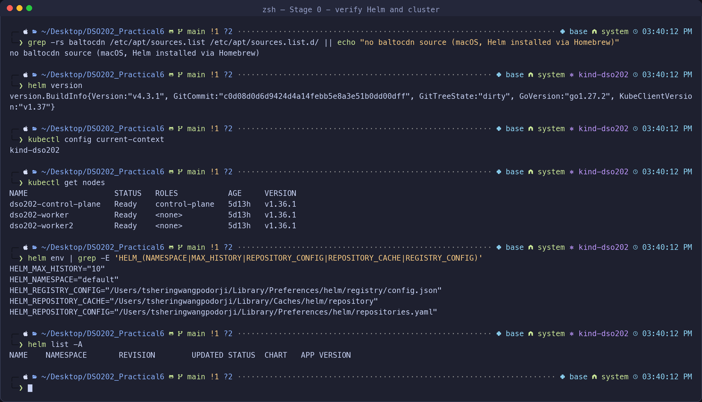

---

## Stage 1 — Consuming a published chart (podinfo)

### Repository, search and reading the chart

`helm repo add` records the URL, and `helm repo update` downloads the index. Searching shows the
**CHART VERSION** and **APP VERSION** columns. The chart was read with `helm show chart` and
`helm show values` before installing it. podinfo still uses the legacy `apiVersion: v1` chart format.

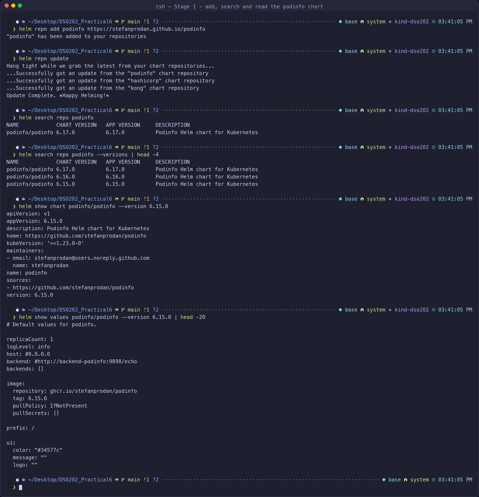

### Installing the release

The chart was installed as `my-podinfo`. The command pins `--version 6.15.0` and overrides two
values. It reports `STATUS: deployed`, revision 1. `helm list` without `-n` is empty because
the release lives in `dso202-helm`.

> The first install attempt timed out because the image pull from `ghcr.io` was slow on
> one worker node. It was uninstalled and re-run once the image was cached
> (see `evidence/stage1-consume-chart-part1.txt`).

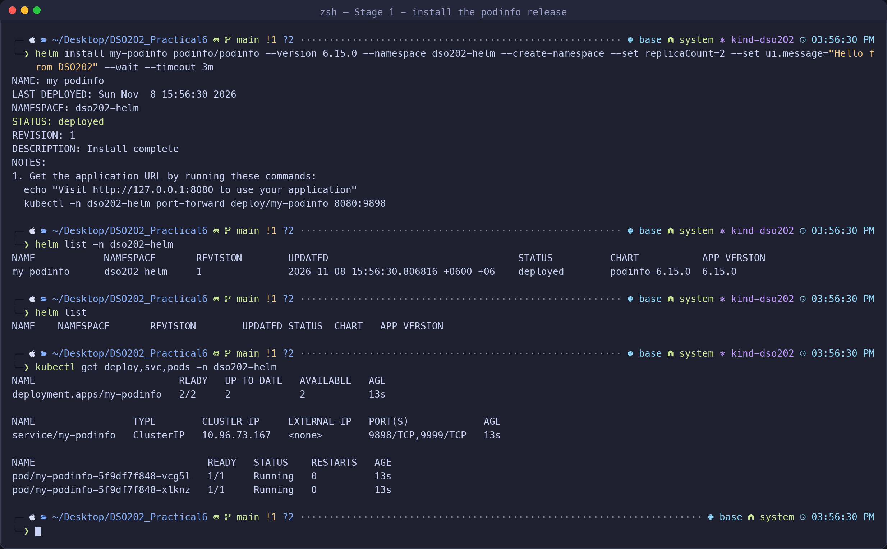

### Reaching the application and inspecting the release

Through a port-forward, podinfo returns the custom message `Hello from DSO202`.
`helm status` lists the live resources. `helm get values` shows only the user-supplied values,
while `--all` shows the merged values.

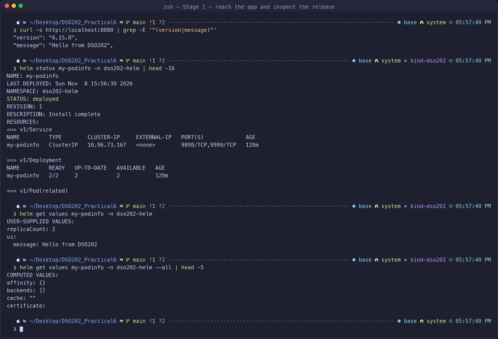

### The release record

The release is stored as the Secret `sh.helm.release.v1.my-podinfo.v1`. Decoding it
(base64 → base64 → gunzip → jq) shows that the values are kept in the cluster in readable form,
and that Helm 4 used server-side apply (`"apply_method": "ssa"`).

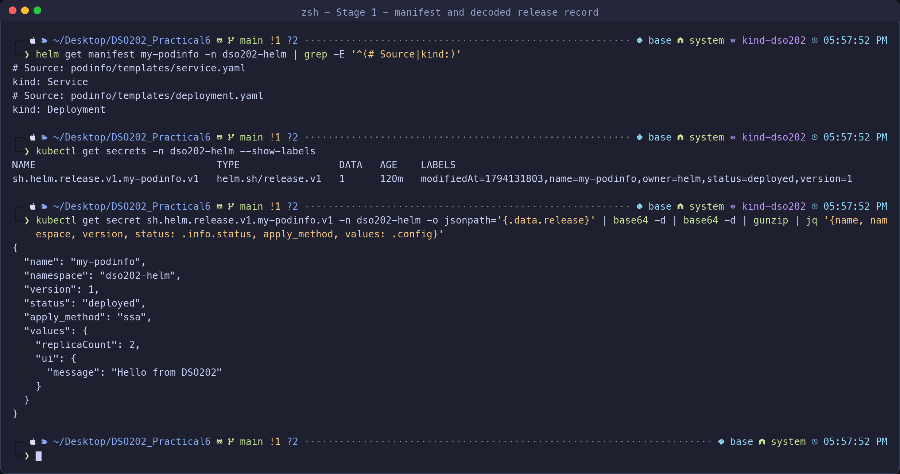

### Upgrade failure: values silently lost

Upgrading with only `--set ui.color=…` discarded the install-time values. The replicas
dropped from **2 to 1** and the message disappeared. Re-running the upgrade with `--reuse-values` merged
the old and new values again.

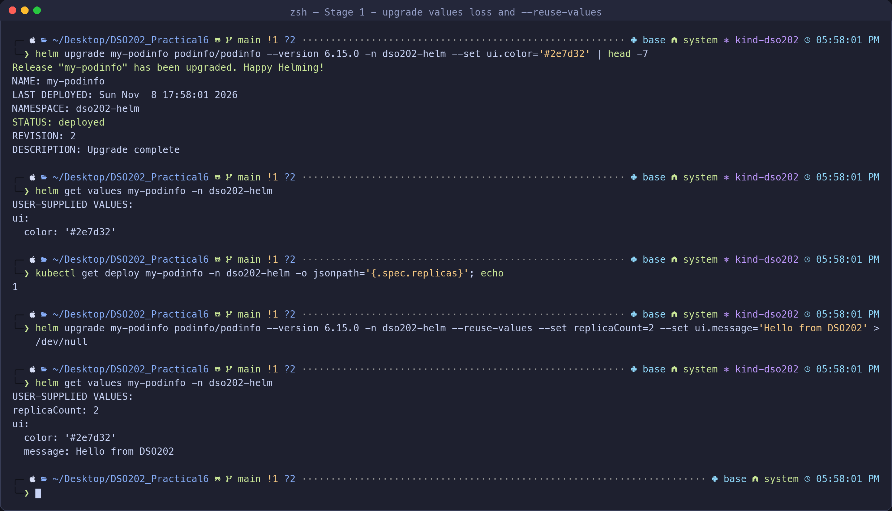

### Rollback, history and uninstall

`helm rollback my-podinfo 1` did not rewrite history. It created **revision 4** ("Rollback to 1").
The values of any earlier revision can still be read with `--revision`. `helm uninstall` removed
every object and record, but the namespace remained because `--create-namespace` does not make
it part of the release.

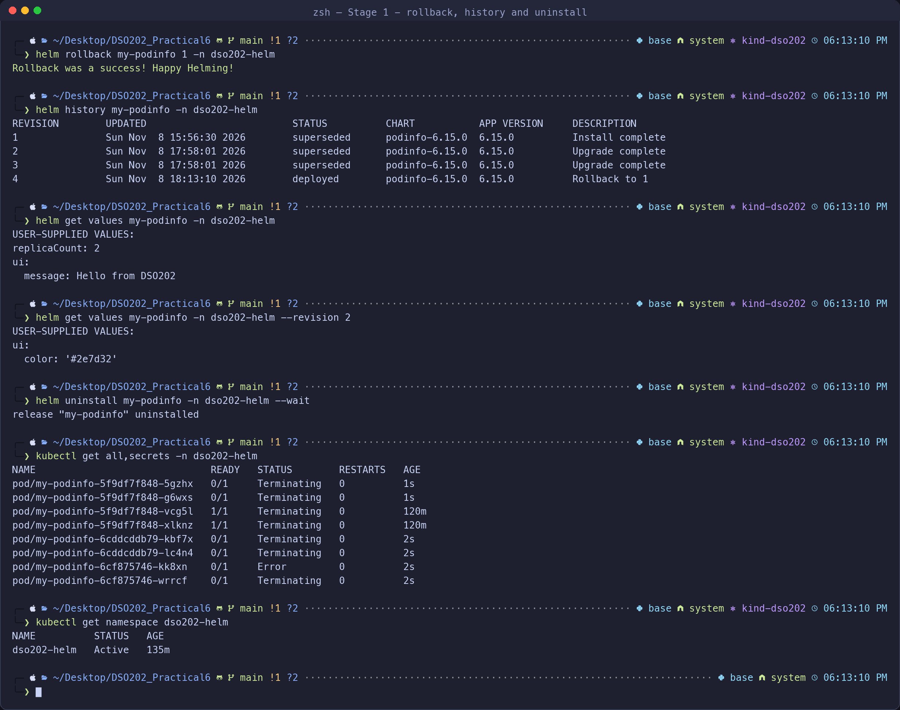

### Installing from an OCI registry

The same chart was installed straight from `oci://ghcr.io/stefanprodan/charts/podinfo`, with no
`helm repo add`. Helm printed the artifact digest.

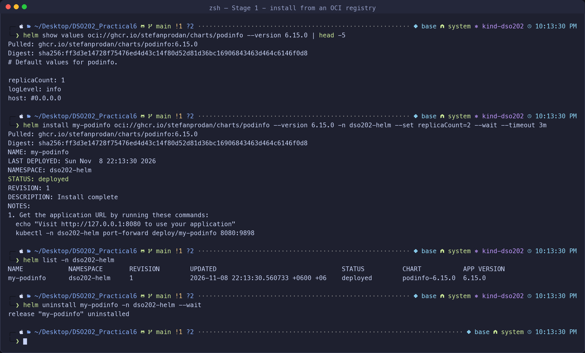

---

## Stage 2 — Chart structure and `Chart.yaml`

`helm create scaffold` was run to see the reference layout (Helm 4 now includes `httproute.yaml`),
and the scaffold was then removed. The smaller `webapp` chart was written file by file.
`Chart.yaml` separates the chart `version` (0.1.0) from the quoted `appVersion` ("1.30-alpine").

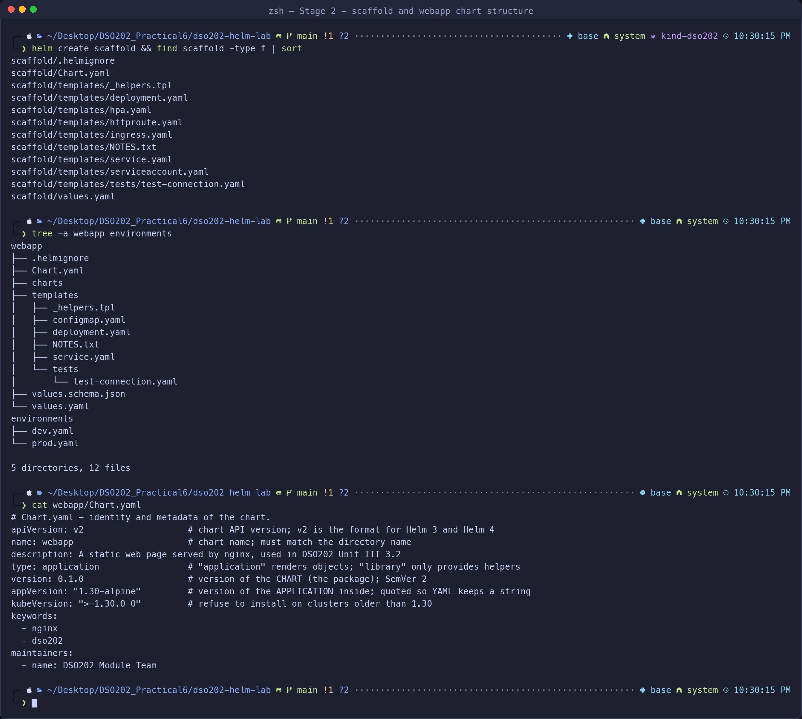

---

## Stage 3 — Writing the `webapp` templates

The templates follow the usual industry conventions:

- named helpers in `_helpers.tpl`;
- the recommended `app.kubernetes.io/*` labels;
- a small, stable selector label set;
- 63-character name truncation;
- a `checksum/config` annotation, so that a ConfigMap change rolls the Pods.

`helm template` shows that objects are sorted by kind (ConfigMap → Service → Deployment → test Pod).
It also shows that the image tag falls back to `appVersion`. The checksum
`534e2ce7…` is identical to the one in the module notes.

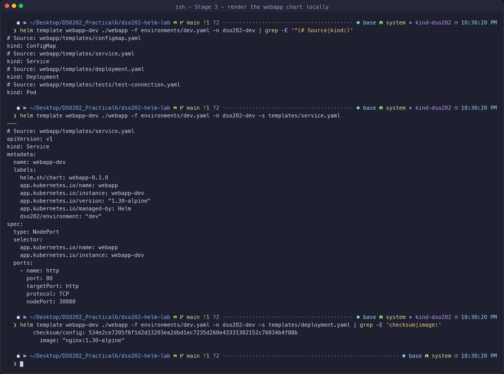

---

## Stage 4 — Values: sources, precedence and merging

- `--set replicaCount=2` overrides the value from the `-f` file.
- Layering `-f dev.yaml -f prod.yaml` leaks dev's **NodePort 30080** into a prod render.
  The reverse order leaks prod's CPU settings into dev. An environment file must therefore be used
  on its own.
- `--set` turns `true` into a boolean (an invalid annotation value), while `--set-string` keeps it a string.
- Setting `resources.limits=null` deletes the chart default.

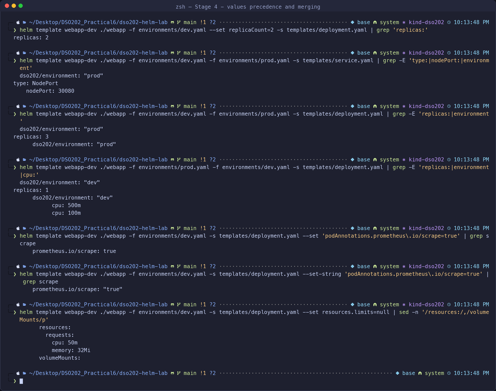

---

## Stage 5 — Validating charts before installation

### Failure 1 — missing required value

Without an environment, `helm template` stops with the chart's own `required` message.
`helm lint` and even `helm lint --strict` only **warn**, and exit with code 0.

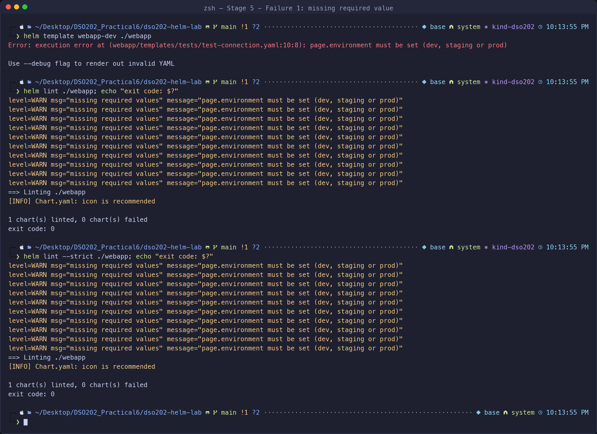

### Failure 2 — indentation

Using `toYaml` without `nindent` (tried on a scratch copy of the chart) produces a YAML parse error.
`--debug` shows that only the first line of the block was indented.

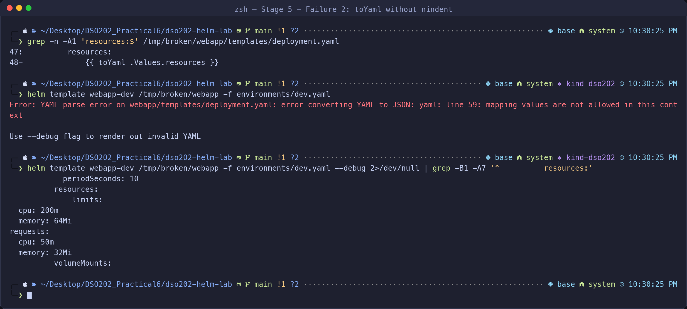

### Failure 3 — a number where a string was meant, fixed by a schema

`tag: 1.30` was parsed as the number 1.3 and silently produced `nginx:1.3`. After adding
`values.schema.json`, the same input is rejected, and the schema reports every violation at once.

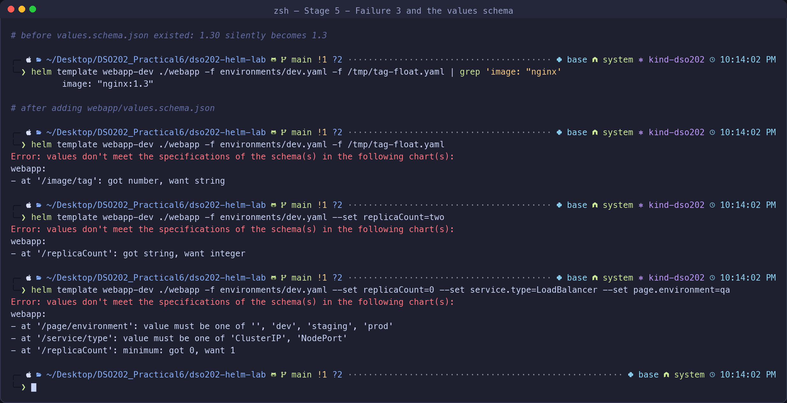

### Failure 4 — a misspelled Kubernetes field

With `replica:` in place of `replicas:`, `helm lint` and `helm install --dry-run=server` both passed.
Only `helm template … | kubectl apply --dry-run=server` rejected the unknown field `spec.replica`.
The corrected chart then passes every check for both environments.

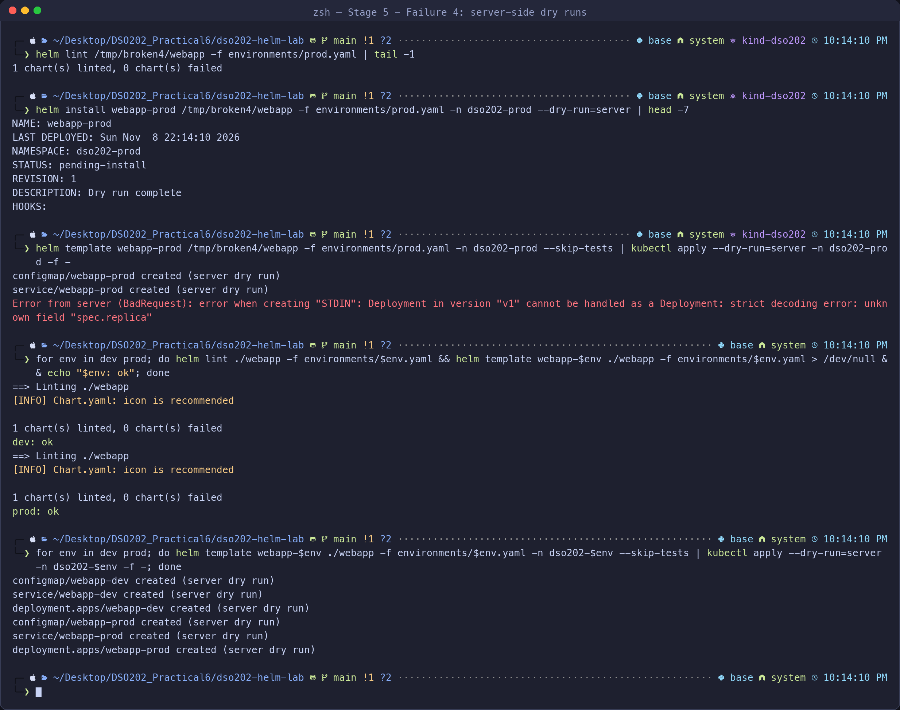

| Check | Missing required value | Wrong value type | Bad indentation | Unknown Kubernetes field |
|---|---|---|---|---|
| `helm lint` | warning only | yes (schema) | yes | no |
| `helm template` | yes | yes (schema) | yes | no |
| `helm install --dry-run=server` | yes | yes (schema) | yes | no |
| `helm template \| kubectl apply --dry-run=server` | yes | yes (schema) | yes | **yes** |

---

## 3.2.3 — Install, upgrade, rollback and release history

### Deploying dev and prod

Both environments were deployed with the idempotent CI form
`helm upgrade --install … --rollback-on-failure`. Dev runs 1 replica behind NodePort 30080, and
prod runs 3 replicas behind a ClusterIP Service.

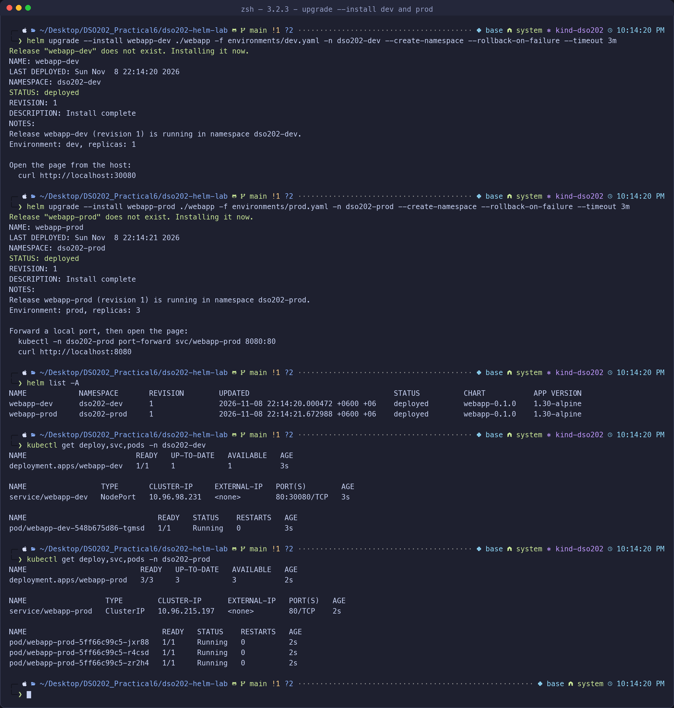

### Reaching the page and running chart tests

`curl http://localhost:30080` returns the dev page rendered from values. `helm test` runs the
`test-connection` Pod for each release, and both finish with `Phase: Succeeded`.

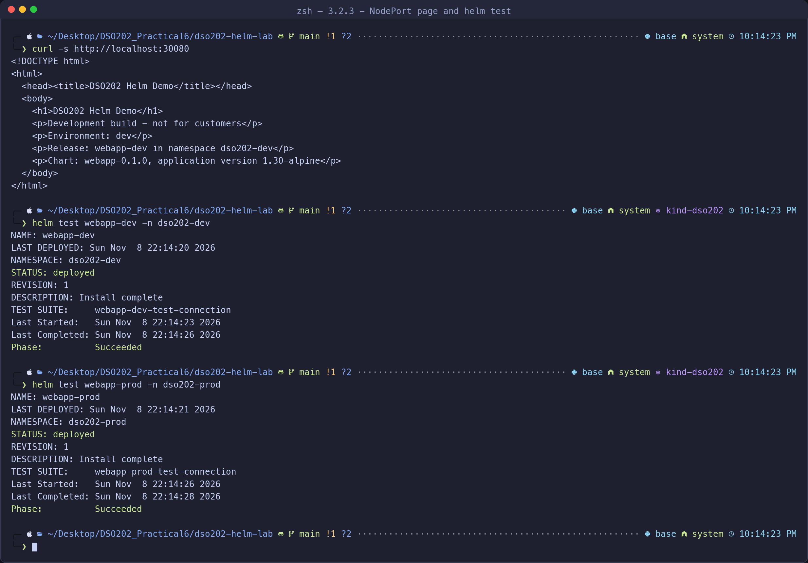

### Upgrade with a checksum-driven rollout

Changing the page message changed the `checksum/config` annotation. The Deployment therefore rolled
out new Pods (Deployment revision 2), and the new message is served.

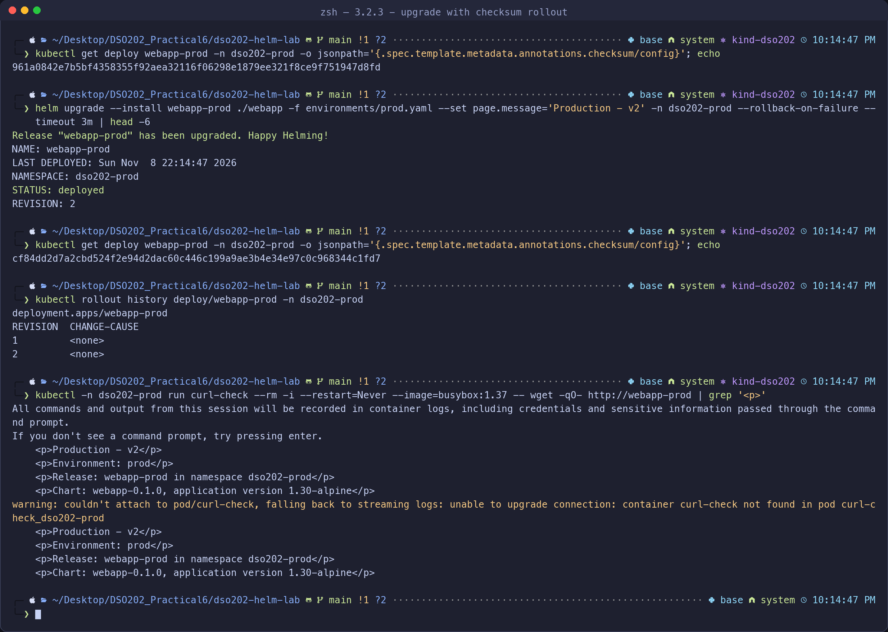

### Automatic and manual rollback

An upgrade with a non-existent image tag timed out. `--rollback-on-failure` rolled it back
automatically: revision 3 is `failed`, and revision 4 is "Rollback to 2". A manual
`helm rollback webapp-prod 1` then created revision 5 and restored the original page.

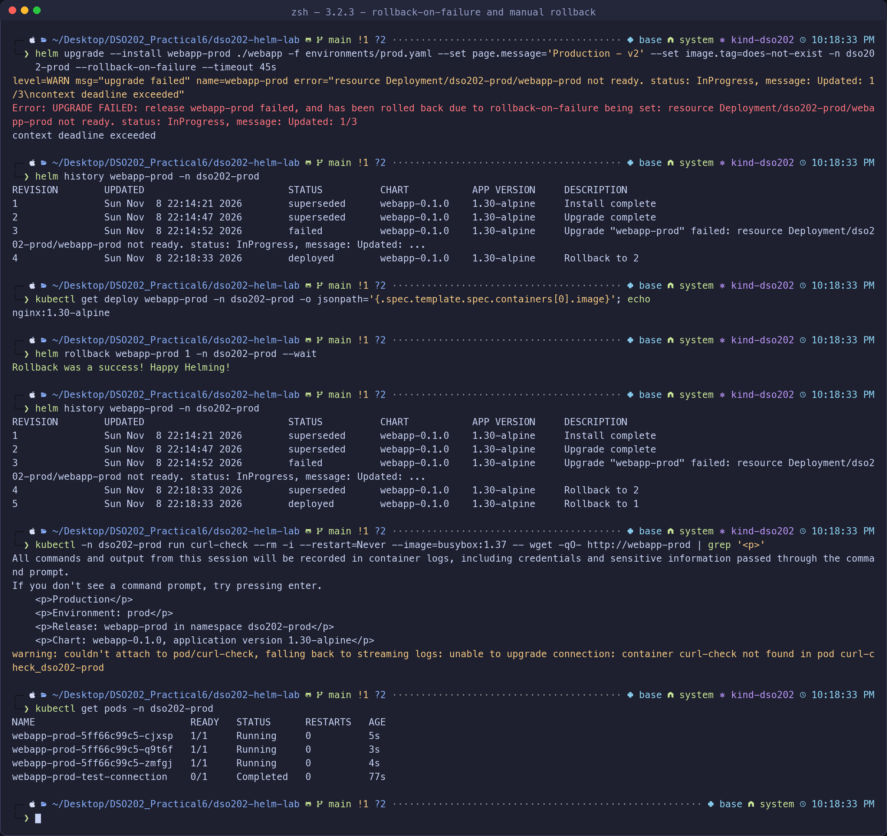

---

## Stage 6 — Drift, ownership and conflicts (Helm 4 server-side apply)

### Drift detected as a conflict

After `kubectl scale --replicas=5`, the next `helm upgrade` failed with a server-side apply
**conflict**. The field `.spec.replicas` is now owned by the `kubectl` field manager.
`--force-conflicts` took ownership back and restored 3 replicas.

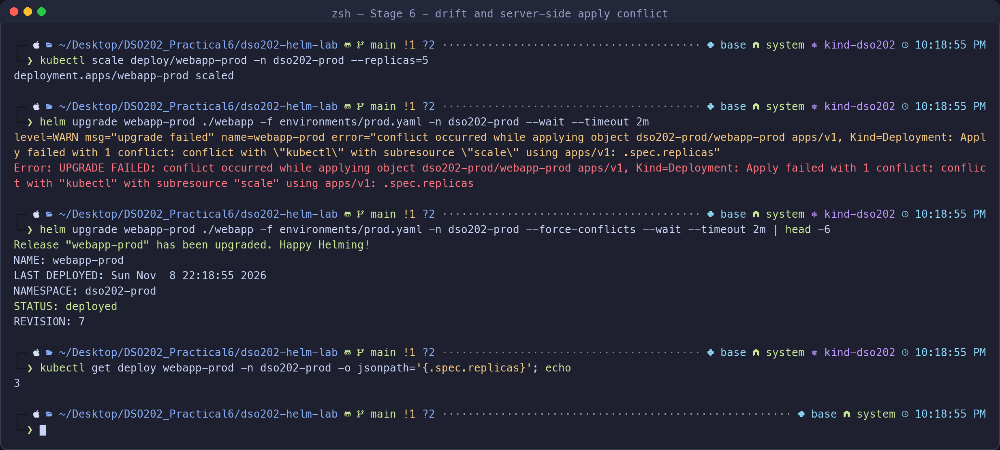

### Helm refuses to adopt objects it did not create

A ConfigMap created by hand blocked the install, because it lacks Helm's ownership markers.
`--take-ownership` adopted it and added `app.kubernetes.io/managed-by: Helm` and the release annotations.

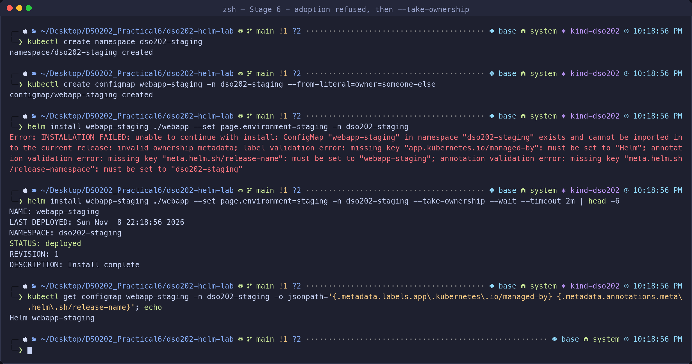

### Two Services cannot hold the same NodePort

A second release asking for NodePort 30080 was rejected by the API server with
`provided port is already allocated`, and Helm recorded that revision as `failed`.

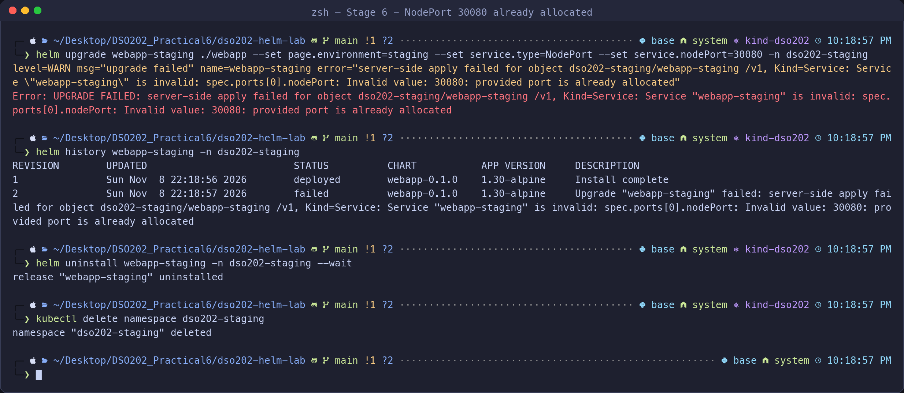

---

## Final state

The chart lints cleanly and is packaged as `webapp-0.1.0.tgz`. Both releases are `deployed`, and
the prod history records every install, upgrade, failure and rollback.

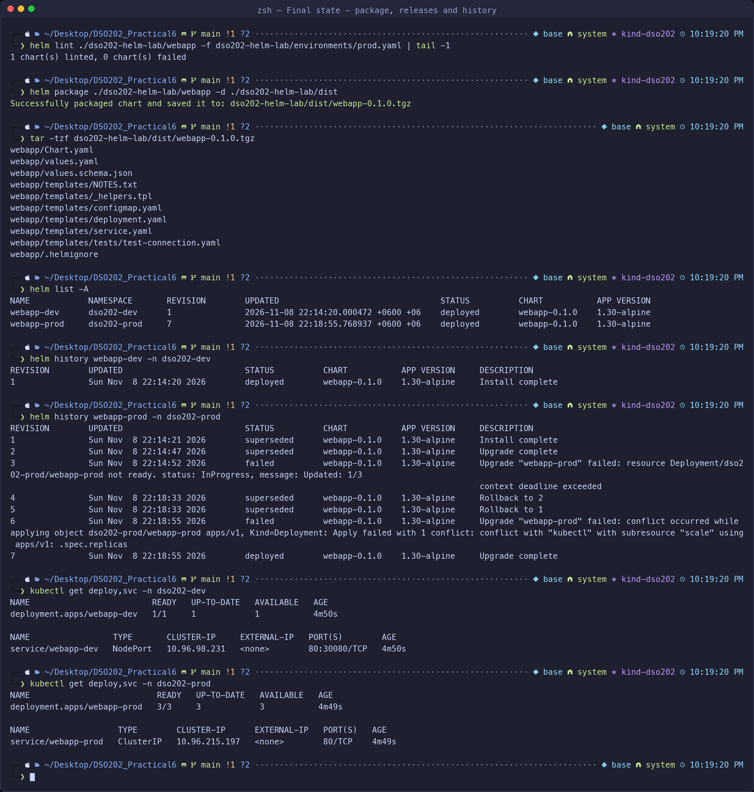

## Reproducing

```bash
cd dso202-helm-lab
for env in dev prod; do
  helm lint ./webapp -f environments/$env.yaml
  helm template webapp-$env ./webapp -f environments/$env.yaml -n dso202-$env --skip-tests \
    | kubectl apply --dry-run=server -n dso202-$env -f -
  helm upgrade --install webapp-$env ./webapp -f environments/$env.yaml \
    -n dso202-$env --create-namespace --rollback-on-failure --timeout 3m
  helm test webapp-$env -n dso202-$env
done
curl http://localhost:30080
```

## Conclusion

Helm packages the application's manifests into one versioned chart. Each environment is
then a values file rather than a copy of the manifests. Every change is recorded as a
revision that can be inspected and rolled back.

The practical also showed where Helm needs care:

- upgrades that pass only some values silently drop the rest;
- `helm lint` alone misses real errors, so CI must render each environment and run a
  server-side dry run;
- release records store values in readable form in the cluster;
- under Helm 4's server-side apply, changes made outside Helm show up as conflicts rather than
  being silently overwritten.

## Notes on the evidence

- The screenshots in `evidence/screenshots/` were generated from the terminal output captured
  during the practical (`evidence/*.txt`), drawn in the same theme as my terminal.
  The prompt line is decoration; the commands and output are the real ones.
- Broken-template experiments (Stage 5, Failures 2 and 4) were run on throwaway copies of
  the chart in a temporary directory, shown as `/tmp/...`, so the chart in `webapp/` is always
  the working version.
